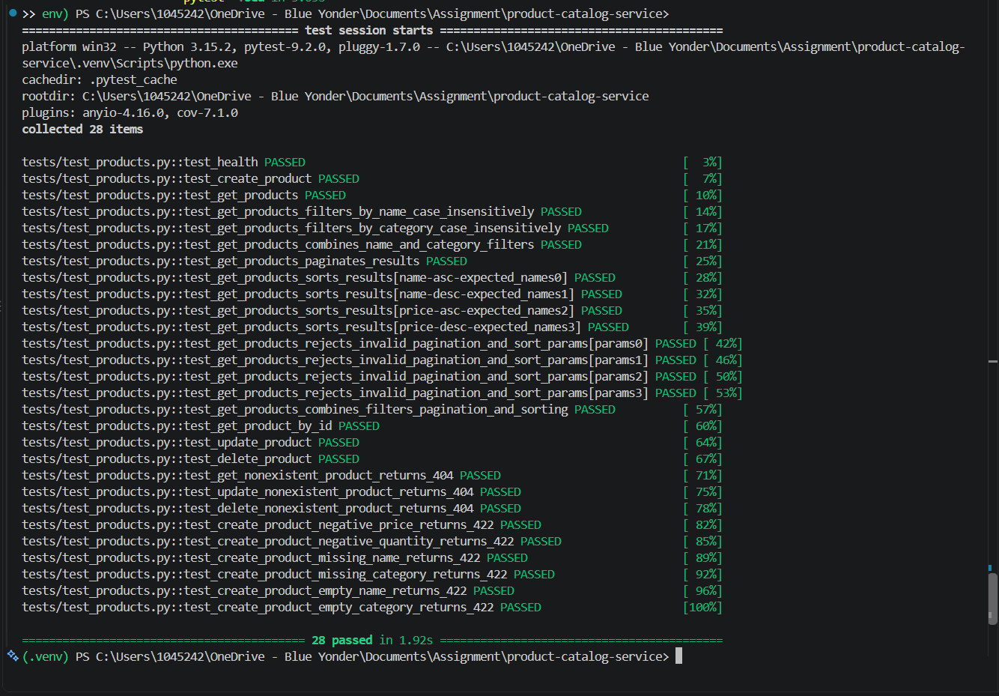
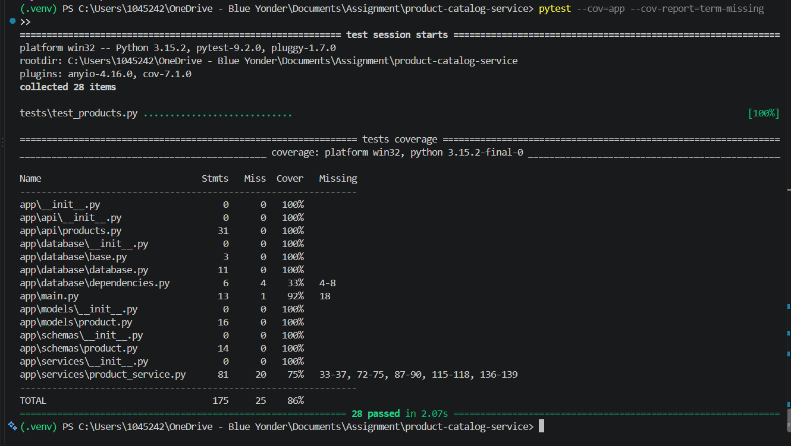
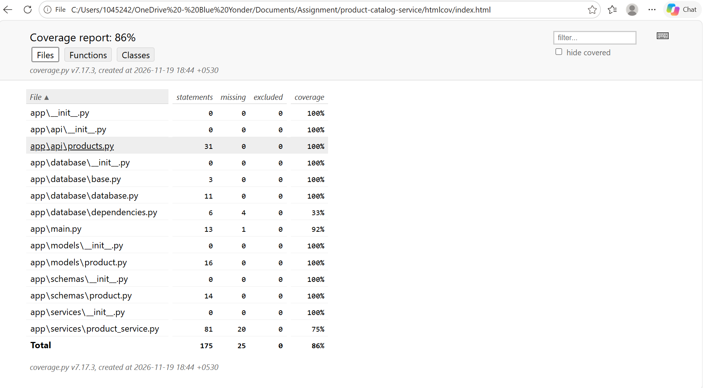

# Product Catalog Service

A RESTful API for managing product records. This project demonstrates a clean FastAPI application structure, PostgreSQL persistence, SQLAlchemy ORM integration, request validation, automated testing, Docker deployment, and continuous integration.

## Project Overview

The Product Catalog Service allows clients to create, view, update, and delete products. Each product is stored in PostgreSQL and identified by a UUID.

The application uses a service layer between the API routes and the database. This keeps HTTP request handling separate from database operations and makes the business logic easier to maintain and test.

### Technology Stack

- Python 3.13
- FastAPI
- PostgreSQL
- SQLAlchemy
- Pydantic
- pytest
- pytest-cov
- Docker
- Docker Compose
- GitHub Actions

## Features

- Create a product
- Retrieve all products
- Search products by name or category
- Combine name and category filters
- Paginate product listings
- Sort products by name or price
- Retrieve a product by UUID
- Update one or more product fields
- Delete a product
- Validate required fields and numeric constraints
- Interactive Swagger API documentation
- Health check endpoint
- SQLite-based automated test isolation
- Docker and Docker Compose support
- Automated tests through GitHub Actions

## Architecture

```text
Client
  |
  v
FastAPI API routes
  |
  v
Service layer
  |
  v
SQLAlchemy ORM
  |
  v
PostgreSQL
```

The API routes handle HTTP requests and responses. The service layer performs product operations and database error handling. SQLAlchemy maps service operations to the PostgreSQL `products` table.

### Data Model

| Field | Type | Validation / Description |
|---|---|---|
| `id` | UUID string | Automatically generated primary identifier |
| `name` | string | Required; must contain at least one character |
| `category` | string | Required; must contain at least one character |
| `price` | float | Required for creation; must be greater than or equal to 0 |
| `quantity` | integer | Required for creation; must be greater than or equal to 0 |
| `created_at` | datetime | Automatically generated creation timestamp |

## Project Structure

```text
product-catalog-service/
├── .github/
│   └── workflows/
│       └── ci.yml
├── app/
│   ├── api/
│   │   └── products.py
│   ├── database/
│   │   ├── database.py
│   │   └── dependencies.py
│   ├── models/
│   │   └── product.py
│   ├── schemas/
│   │   └── product.py
│   ├── services/
│   │   └── product_service.py
│   └── main.py
├── tests/
│   ├── conftest.py
│   └── test_products.py
├── .env
├── Dockerfile
├── docker-compose.yml
├── requirements.txt
└── README.md
```

## Setup Instructions

### Prerequisites

- Python 3.13 or a compatible Python 3 version
- PostgreSQL 18 or a compatible PostgreSQL version
- Docker Desktop (optional, for container-based setup)
- Git

### 1. Clone the Repository

```bash
git clone https://github.com/by-vanshul/product-catalog-service.git
cd product-catalog-service
```

### 2. Create and Activate a Virtual Environment

**Windows:**

```powershell
python -m venv .venv
.venv\Scripts\Activate.ps1
```

**Linux or macOS:**

```bash
python -m venv .venv
source .venv/bin/activate
```

### 3. Install Dependencies

```bash
python -m pip install --upgrade pip
pip install -r requirements.txt
```

### 4. Configure PostgreSQL

Create a PostgreSQL database named `product_catalog`, or use the database name configured in your `.env` file.

The application creates the required SQLAlchemy table automatically when it starts.

## Environment Variables

Create a `.env` file in the project root:

```env
DB_HOST=localhost
DB_PORT=5432
DB_NAME=product_catalog
DB_USER=postgres
DB_PASSWORD=xxxx
```

| Variable | Description | Local Example |
|---|---|---|
| `DB_HOST` | PostgreSQL host | `localhost` |
| `DB_PORT` | PostgreSQL port | `5432` |
| `DB_NAME` | PostgreSQL database name | `product_catalog` |
| `DB_USER` | PostgreSQL username | `postgres` |
| `DB_PASSWORD` | PostgreSQL password | `xxxx` |

For Docker Compose, `DB_HOST` is automatically set to `db`, which is the database service name. Use the same database name, username, and password for both the API and PostgreSQL containers.

## Running Locally

Make sure PostgreSQL is running and the `.env` values are correct. Start the API with Uvicorn:

```bash
uvicorn app.main:app --reload
```

The service will be available at:

- API: `http://localhost:8000`
- Swagger documentation: `http://localhost:8000/docs`
- ReDoc documentation: `http://localhost:8000/redoc`
- Health check: `http://localhost:8000/health`

## Running with Docker

Build and start the API and PostgreSQL containers:

```bash
docker compose up --build
```

Stop and remove the containers:

```bash
docker compose down
```

Docker Compose exposes the API on port `8000` and PostgreSQL on port `5432`.

- API: `http://localhost:8000`
- Swagger UI: `http://localhost:8000/docs`
- PostgreSQL: `localhost:5432`

## Running Tests

The test suite uses an in-memory SQLite database to isolate tests and avoid requiring a local PostgreSQL instance.

Run all tests:

```bash
pytest
```

Run tests verbosely:

```bash
pytest -v
```

The test suite contains 28 passing tests.



## Test Coverage

Run the tests with a coverage report:

```bash
pytest --cov=app --cov-report=term-missing
```



Generate an HTML coverage report:

```bash
pytest --cov=app --cov-report=html
```



The HTML report is created in the `htmlcov/` directory. The project currently has 86% test coverage.

## API Endpoints

All product endpoints use JSON.

### Root

```http
GET /
```

Response:

```json
{
  "message": "Product Catalog Service"
}
```

### Health Check

```http
GET /health
```

Response:

```json
{
  "status": "UP"
}
```

### Create a Product

```http
POST /products
Content-Type: application/json
```

Request:

```json
{
  "name": "Wireless Mouse",
  "category": "Accessories",
  "price": 29.99,
  "quantity": 10
}
```

Success response: `201 Created`

```json
{
  "id": "bdb4fc40-12d8-4f4f-a7d9-7fe4a9d0e123",
  "name": "Wireless Mouse",
  "category": "Accessories",
  "price": 29.99,
  "quantity": 10,
  "created_at": "2026-11-19T10:30:00"
}
```

### Get All Products

```http
GET /products
```

Success response: `200 OK`

### Search and Filter Products

The product listing endpoint accepts optional `name` and `category` query parameters. Each value matches a case-insensitive substring. When both are provided, a product must match both filters.

```http
GET /products?name=mouse
GET /products?category=accessories
GET /products?name=wireless&category=accessories
```

Example:

```bash
curl "http://localhost:8000/products?name=wireless&category=accessories"
```

The response is a `200 OK` list of products that match the filters. Omitting both parameters returns all products.

### Pagination and Sorting

Product listing supports pagination with `page` (default `1`) and `size` (default `10`). Pages start at 1, and size must be greater than 0. Sorting is optional: `sort_by` accepts `name` or `price`, and `order` accepts `asc` or `desc` (default `asc`). When no sort field is provided, results use a stable identifier order for consistent pagination.

```http
GET /products?page=1&size=10
GET /products?page=2&size=5
GET /products?sort_by=name&order=asc
GET /products?sort_by=price&order=desc
GET /products?name=iphone&category=mobile&page=1&size=10&sort_by=price&order=desc
```

Unsupported sort fields or directions, page values below 1, and sizes below 1 return `422 Unprocessable Entity`. The response remains a list of products; it does not include total-result metadata.

### Get a Product by ID

```http
GET /products/{product_id}
```

Example:

```bash
curl http://localhost:8000/products/bdb4fc40-12d8-4f4f-a7d9-7fe4a9d0e123
```

Success response: `200 OK`

If the product does not exist:

```json
{
  "detail": "Product not found"
}
```

### Update a Product

```http
PUT /products/{product_id}
Content-Type: application/json
```

Request example:

```json
{
  "price": 34.99,
  "quantity": 7
}
```

Success response: `200 OK`

The update schema allows `name`, `category`, `price`, and `quantity`. Only fields included in the request are changed.

### Delete a Product

```http
DELETE /products/{product_id}
```

Success response: `200 OK`

The response contains the deleted product. A later request for the same product returns `404 Not Found`.

### Validation Errors

Invalid input returns `422 Unprocessable Entity`. For example, negative prices and quantities are rejected, `name` or `category` cannot be omitted or empty, and invalid pagination or sorting parameters are rejected.

## CI/CD

GitHub Actions runs a CI workflow on every push to the `main` branch and for pull requests. The workflow:

1. Checks out the repository.
2. Sets up Python 3.13.
3. Installs dependencies from `requirements.txt`.
4. Runs the pytest test suite.

The workflow is configured in `.github/workflows/ci.yml`.

## Design Decisions

- A service layer separates API routing from business logic and SQLAlchemy operations.
- PostgreSQL provides persistent, relational storage for products.
- SQLAlchemy ORM manages database records and schema access.
- UUID strings provide unique product identifiers.
- Pydantic schemas validate incoming data and serialize API responses.
- Product listing supports case-insensitive substring search by name and category, and combines both filters when provided.
- SQLAlchemy applies listing filters, stable pagination, and allowlisted sorting by name or price.
- Environment variables keep database configuration outside the source code.
- SQLite is used during automated tests to keep tests isolated and faster.
- Docker and Docker Compose separate the application and database into independent containers.
- FastAPI's built-in Swagger UI provides browsable API documentation.

## Future Enhancements

- Add authentication and role-based authorization
- Add database migrations with Alembic
- Add persistent Docker volumes for PostgreSQL
- Add API and service unit tests for additional database error cases
- Add structured application logging and monitoring
- Add integration tests against a PostgreSQL test container
